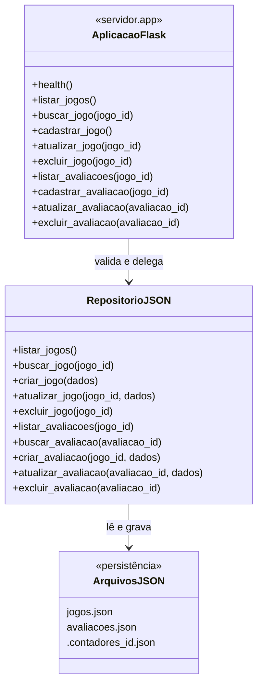

# Arquitetura e padrões

## Organização atual

- `servidor/app.py`: aplicação Flask, rotas HTTP e validação dos dados recebidos.
- `servidor/storage/repositorio_json.py`: repositório local, independente de
  Flask e Qt.
- `dados/jogos.json`: lista persistente de jogos.
- `dados/avaliacoes.json`: lista persistente de avaliações.
- `dados/.contadores_id.json`: histórico auxiliar de IDs; criado localmente para
  impedir reutilização de IDs após exclusões.
- `cliente/`: estrutura reservada à interface Qt e integração HTTP; as classes
  do cliente ainda não estão presentes neste checkout.

Os registros são armazenados como objetos JSON. O vínculo entre avaliação e jogo
é mantido pelo campo `jogo_id`. Os arquivos de produção começam como listas
vazias; os testes usam caminhos temporários.

## Diagrama de classes do servidor

Esse diagrama representa o servidor atualmente implementado: não há classes de
modelo separadas; os dados trafegam como dicionários. Revisar o diagrama com
Gabriel ao aprovar o contrato.

## Diagrama de classes do cliente

**Pendente:** as pastas `cliente/telas/` e `cliente/services/` ainda não contêm
classes de aplicação. O README do cliente prevê PySide6 e dados inicialmente
simulados, mas isso não é evidência suficiente para inventar nomes, atributos
ou relações. Solicitar a Edino a estrutura real e incluir o diagrama após a
implementação inicial da interface.

## Padrões e decisões

### Repository

`RepositorioJSON` concentra as operações de leitura e escrita e oculta os
caminhos e detalhes do formato persistido. `servidor/app.py` consome essa
interface em vez de manipular diretamente os arquivos, facilitando trocar a
implementação por um repositório de memória nos testes da API.

### Substituição atômica de arquivos

As listas e os contadores são serializados em arquivo temporário no mesmo
diretório e publicados por substituição (`os.replace`). Isso reduz o risco de
deixar um JSON pela metade se a gravação for interrompida. Essa garantia não é
uma transação entre os dois arquivos de dados: falhas durante exclusão em
cascata podem exigir reconciliação.

### IDs persistentes

Os últimos IDs emitidos são guardados em arquivo auxiliar, além do maior ID
presente na lista atual. Assim, excluir o registro de maior ID e reiniciar o
servidor não leva à reutilização desse ID. Se o arquivo auxiliar estiver
corrompido, o repositório preserva uma cópia e informa o erro em vez de
reinicializar silenciosamente o contador.

## Limites conhecidos

- Os arquivos locais são apropriados para execução acadêmica em uma instância;
  o repositório não implementa bloqueio para múltiplos processos concorrentes.
- Uma atualização que envolva `jogos.json` e `avaliacoes.json` não é transacional.
- A execução atual do servidor usa modo de depuração; não expor essa
  configuração em implantação pública.
