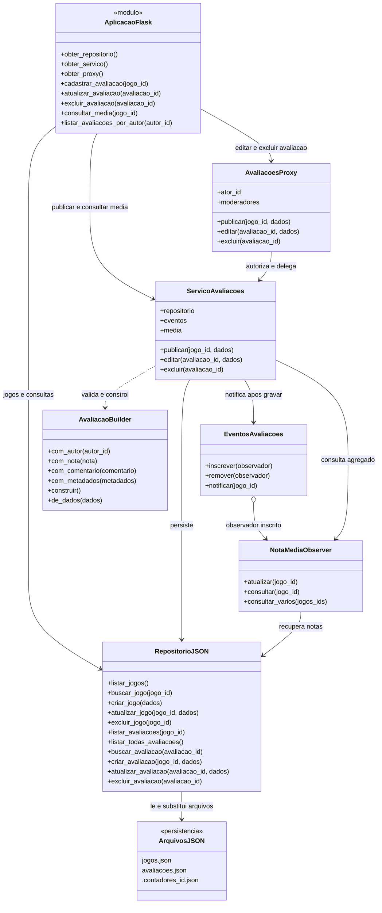
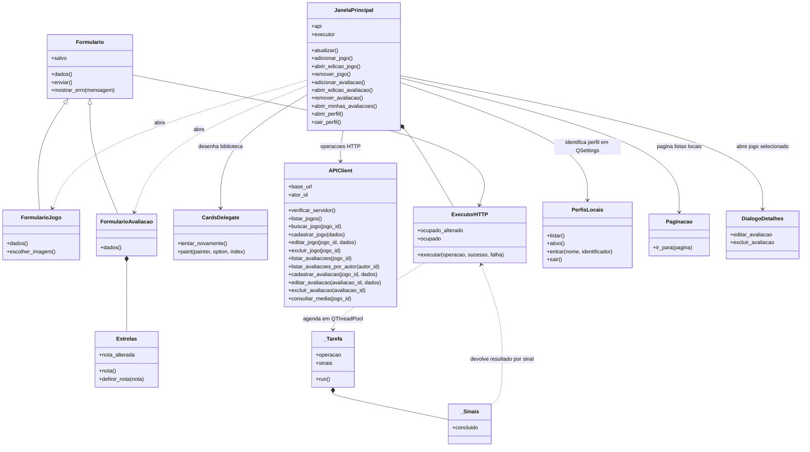

# Arquitetura e padrões

Revisão técnica: 24/10/2026. Os diagramas representam as classes presentes no
código. Jogos e avaliações trafegam como dicionários, sem classes de entidade
separadas.

## Organização

| Componente | Implementação | Responsabilidade |
|---|---|---|
| API Flask | `servidor/app.py` | Rotas, validação, respostas e composição dos serviços. |
| Validação da API | `servidor/validacoes.py` | Normalização dos campos e rejeição de corpos JSON inválidos. |
| Padrões | `servidor/patterns/avaliacoes.py` | Builder, Proxy, eventos e cálculo da média. |
| Repository | `servidor/storage/repositorio_json.py` | CRUD, JSON e histórico de IDs. |
| Inicialização Qt | `cliente/main.py` | Configura a aplicação e abre a janela principal. |
| Interface | `cliente/telas/` | Catálogo, filtros, perfis locais, Minhas avaliações, paginação, detalhes, formulários, estrelas e capas. |
| Cliente HTTP | `cliente/services/api_client.py` | Requisições e interpretação das respostas. |
| Execução assíncrona | `cliente/services/tarefas.py` | HTTP fora da thread gráfica, resultados por sinais. |

O Qt acessa os dados pelo HTTP. Somente o servidor lê e grava jogos, avaliações
e contadores. Preferências visuais, como caminhos de capas locais, ficam no
`QSettings` do cliente.

O catálogo usa `GET /jogos?com_medias=1`; Minhas avaliações usa
`GET /autores/<autor_id>/avaliacoes`, com registros do jogo e da avaliação.
Cada listagem requer uma chamada HTTP. Na consulta por autor, o Flask cruza
jogos e avaliações em memória, com uma leitura de cada arquivo. Busca, filtros
e paginação são feitos no cliente sobre os dados recebidos. Downloads de capas
e consultas dos detalhes são operações separadas.

A montagem da janela principal está dividida em métodos por área: cabeçalho,
marca, status, conteúdo, biblioteca, busca, perfil, filtros e detalhes.
`_montar_tela()` apresenta a ordem dessa composição. As regras dos corpos JSON
ficam em `servidor/validacoes.py`; `app.py` usa essas funções ao receber requisições.
Consulte o [guia de leitura do código](guia-do-codigo.md) para acompanhar um fluxo completo.

## Diagrama de classes do servidor

`AplicacaoFlask` representa o módulo de rotas, não uma classe Python adicional.
`ArquivosJSON` representa os arquivos persistidos.

## Diagrama de classes do cliente

Os métodos omitidos são auxiliares de desenho e montagem. As setas representam
dependências e relações presentes nos módulos do cliente.

`JanelaPrincipal` herda de `QMainWindow`, `Formulario` de `QDialog`, `Estrelas`
de `QWidget`, `CardsDelegate` de `QStyledItemDelegate`, `ExecutorHTTP` e `_Sinais`
de `QObject`, e `_Tarefa` de `QRunnable`.

## Aplicação dos padrões

- **Builder (criacional):** reúne autor, nota, comentário e metadados, valida
  os valores e devolve cópia dos dados. O repositório gera o ID.
- **Proxy (estrutural):** controla edição e exclusão individual. Autor e
  moderadores configurados podem agir; avaliações sem autor ficam para leitura.
  Os IDs são fictícios e não constituem autenticação.
- **Observer (comportamental):** eventos após publicação, edição e exclusão
  atualizam média aritmética e quantidade. A consulta reconstrói o resultado
  após reinício ou exclusão em cascata.
- **Repository:** concentra leitura, gravação e geração de IDs.

Publicação: Qt -> HTTP -> Flask -> serviço -> Builder -> JSON -> evento ->
Observer. Edição e exclusão individual passam pelo Proxy antes do serviço.
Excluir um jogo utiliza a cascata do repositório, inclusive para avaliações
legadas, sem autorização individual de cada avaliação removida.

## Persistência, falhas e limites

- Escrita atômica por arquivo: temporário no mesmo diretório e `os.replace`.
- Contadores preservam o maior ID histórico; exclusões não os reduzem.
- JSON inválido é preservado em `.bak` antes da recuperação. Contadores
  corrompidos geram erro, evitando reinicialização silenciosa do histórico.
- A cascata prepara jogos, avaliações e contadores antes das gravações da
  exclusão. Se a escrita das avaliações falha, tenta restaurar os jogos. Se
  a restauração falha, informa as duas falhas. Não é transação entre arquivos
  nem recuperação garantida após encerramento abrupto do processo.
- Falhas de observadores são registradas sem desfazer a operação persistida
  nem impedir os demais observadores. Falhas de persistência continuam como erro.
- O cliente serializa suas tarefas HTTP; o servidor não implementa bloqueio
  global contra gravações simultâneas de vários clientes ou processos.
- Os sinais das tarefas pertencem ao `ExecutorHTTP` na thread gráfica.
  A conclusão usa conexão enfileirada; o objeto de sinais é liberado por
  `deleteLater()` na mesma thread, evitando sua destruição pela thread de trabalho.
- O Flask inicia com `app.run(debug=False)`, para demonstração local.
- Capas locais dependem do arquivo escolhido; links dependem do endereço
  informado. As operações principais podem ser demonstradas sem capas.

## Evidências

Consulte [os testes](../testes/README.md), os
[requisitos e critérios](requisitos-e-aceitacao.md) e o
[roteiro T9.1 a T9.4](entrega-design-patterns.md).
